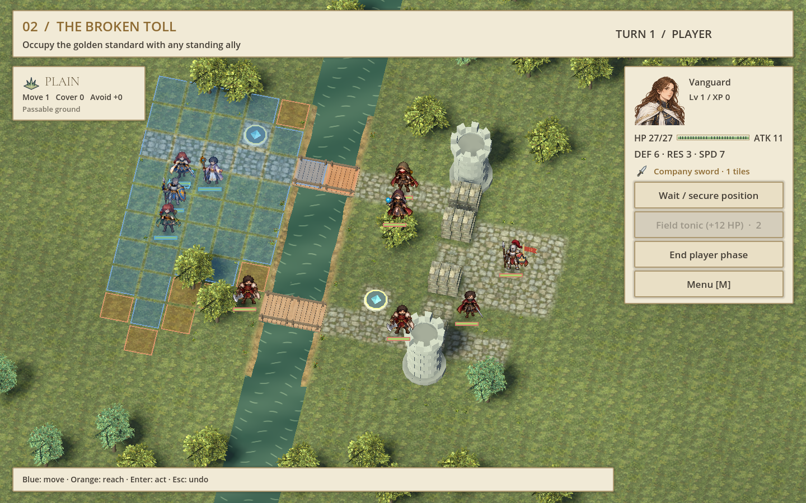
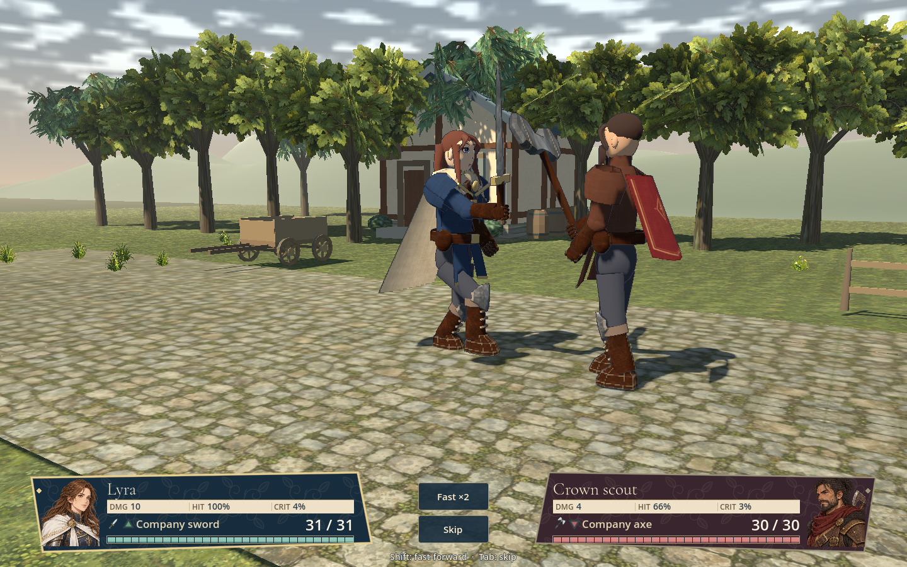
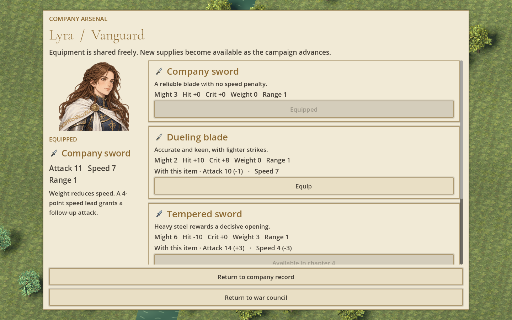

# Poem

A playable tactical RPG prototype built with Godot 4.5.1 and GDScript. Lead 24 recruits through a 12-chapter campaign, choose their equipment and promotions, and build relationships between battles.

The campaign uses animated 2D sprites over textured 3D terrain. Combat zooms enlarge the sprites with tactical indicators hidden. The fighters emerge before the surrounding 3D arena, and the return opens on the same spot on the map with updated health and status. Browser and macOS exports run locally.

[Screenshots](#screenshots) · [Play](#play) · [Controls](#controls) · [Campaign guide](#campaign-guide) · [Saves and options](#saves-and-options) · [Development](#development) · [Testing](#testing) · [Builds](#builds) · [Assets and credits](#assets-and-credits)

## Screenshots

**Tactical battles.** Plan movement and attacks across the campaign's textured battlefields.



<details>
<summary>More screenshots: 3D combat and equipment</summary>

**3D combat.** Lyra faces a Crown scout, with weapon matchups, attack forecasts, and health shown below the arena.



**Company arsenal.** Compare weapons and their effects on attack and speed before equipping them.



</details>

## Play

### From source

1. Install **Godot 4.5.1, standard edition**. The project uses GDScript and the Compatibility renderer; no third-party runtime packages are required.
2. Import [project.godot](project.godot) in the editor and let asset imports finish.
3. Press **F5** to launch the game. Choose **Begin** on the title screen to start a campaign.

### From a local export

For a browser build, serve the exported folder from the repository root:

```sh
python3 -m http.server 8060 --bind 127.0.0.1 --directory build/web
```

Open [localhost:8060](http://localhost:8060) in a desktop-size browser. Music starts after **Begin** or **Continue**. Keep the exported files together and serve them over HTTP.

The browser loading screen shows campaign artwork, a labeled progress bar, and readable startup errors. It gives way to the title screen once the game has started.

For macOS, extract `build/native/Poem.zip` and launch the application inside it.

Exports are generated locally and ignored by Git. If `build/web/index.html` or the native archive is missing, follow [Builds](#builds) first. You can also play directly in the editor without export templates.

### Your first battle

1. At the war council, choose your deployment and open recruit portraits to inspect equipment and abilities. **Positions** lets you swap allies between starting tiles, including empty tiles; choose **Apply formation** to keep the draft. Red markers show enemy details and possible attack reach; **R** shows all enemy reach, with **!** marking threatened starting tiles.
2. Select an ally, then hover a reachable tile to preview the route. Click the tile to move.
3. Select an enemy, review the forecast, and confirm the attack. A staff user can instead select an injured ally within range to heal.
4. Use **Wait** to commit movement without attacking. Right-click or press **Escape** to undo an uncommitted move.
5. End the player phase when ready. Complete the displayed objective to advance to the next chapter.

## Controls

These controls apply to campaign battles; menus and the visual workshop have their own context-sensitive actions. The attack forecast shows a numbered strike order; counters and follow-ups occur only while both units remain standing.

| Action | Control |
| --- | --- |
| Select a unit, move, or choose a target | Left-click |
| Move the map cursor | Arrow keys |
| Select a tile or confirm a forecasted attack | Enter |
| Cycle ready allies | Q / E |
| Wait with the selected ally | W |
| Cancel a drop choice, selection, or uncommitted move | Right-click / Escape |
| Rescue a downed ally | Select an adjacent ready ally, then click the gold patient tile or choose Rescue & triage |
| Place a carried ally | Rescue & triage → Choose drop tile, then click a gold tile or press Enter |
| End the player phase | Space |
| Toggle enemy threat ranges | R |
| Keep the selected enemy’s reach visible | T, or **Track** in its sidebar |
| Open or close the battle menu | M; Escape also closes it |
| Zoom the tactical map | Mouse wheel / + / − |
| Pan the tactical map | Middle-button drag |
| Fit the whole battlefield | Home |
| Skip a chapter card, phase announcement, combat scene, or casualty card | Tab |
| Play combat animation at double speed | Hold Shift, or click **Fast ×2** to toggle |
| Inspect 3D combat at half speed in Debug mode | Hold Z |
| Reveal or advance dialogue | Fresh Space / Enter |
| Read revealed lines in the current conversation | H or **History**; H / Escape returns |
| Apply Options or return from save transfer | Fresh Escape |
| Skip the current dialogue sequence | Fresh Escape |

All 24 recruits change expression during campaign scenes and support conversations.

History pauses text reveal while you reread the current conversation and returns to the same position. Arrow keys, Page Up/Down and Home/End scroll the transcript. Dialogue keys act once per fresh press; held keys do not dismiss following lines. Menu back-navigation also requires a fresh Escape for each level. Enter or Space activates **Skip scene** when that button has keyboard focus.

Click an enemy to inspect its stats and reach. **Track [T]** keeps that enemy’s range visible in purple while you choose allies; it updates with movement and clears when the enemy falls or a new attempt begins. You can track several foes independently of the all-enemy **R** overlay. These map annotations are temporary and excluded from saves. The terrain card follows the pointer or keyboard cursor and shows movement costs and bonuses. Keyboard cursor movement keeps distant tiles in view; map zoom and pan are preserved when returning from combat. Chapter and casualty cards also accept a click to skip. Full combat scenes have **Fast ×2** and **Skip** buttons between the health panels; speed toggles last only for that exchange and clear when the app loses focus. Skip during the opening map zoom returns directly to the map without revealing the combat arena.

## Campaign guide

### Roster and objectives

- **24 named recruits across 8 classes**, each with a portrait, dossier, battle call, casualty dialogue, and epilogue. Recruitment happens automatically at the relevant chapter's war council.
- **12 authored battlefields** with rout, seize, boss, and six-turn defense objectives, opening and closing dialogue, and a campaign ending.
- **12 named enemy commanders** with individual portraits, model palettes, critical calls, and clickable crown markers on the map.
- Persistent levels and experience, deployment selection, and an experimental permadeath toggle.

### Equipment and combat

Open a recruit's portrait at the war council, then **Equipment**, to choose from 24 weapons and staves. Supplies unlock by chapter, and equipment is freely shared. Each alternative previews the recruit’s resulting attack or healing and effective speed, with changes from their equipped item. Enemy equipment appears in models, inspection panels, and forecasts.

Every item has its own inventory artwork. The arsenal, company cards, selected-unit panel, forecasts and combat HUD show the icon for the actual equipped weapon, spellbook or staff. Legacy supplies and the Debug equipment chooser use the same icons.

**Permadeath** is a toggle on the new-campaign screen and in **Options**. Ordinary permadeath commits casualties after a chapter victory. With **Save every action**, deaths commit during battle and survive a retry; movement cannot be undone. Memorial records and read support scenes remain available. Turning permadeath off preserves earlier losses.

The new-campaign screen and Options expose independent campaign experiments: section restarts, increasing enemy preparation after resets, rescuable downed allies, stronger enemy forces, death-triggered legacy supplies, and sacrifice costs/openings. Choices on the new-campaign screen remain a draft until you begin; cancelling preserves the current rules and save. Beginning applies the selected switches to a fresh company, and the first deployment saves them. Harder forces also add a healing Field Warden to fresh deployments in chapters 5, 9 and 12; camp announces their presence. See the [experiment rules and initial balance measurements](docs/campaign-experiments.md) for the exact behavior and current limits.

Debug tools also offers **Stage a combat encounter**: eight reproducible attack/healing positions for inspecting complete scenes. Press Enter to preview an attack, then Enter again to confirm; healing takes one press. These replace only the temporary Debug campaign and retain your model and combat-display choices. During a Debug battle, **M → Combat encounters** reopens the list; Escape returns without changing the current position. Its current/revised buttons compare whole model sets inside Debug without changing the campaign’s presentation preference.

Choose **Debug tools → Replay dialogue** to preview any chapter opening or closing and all 36 support conversations, including locked ranks. Turn on **Apply current campaign losses** to preview survivor dialogue for the current Debug roster. Replays use the usual portraits, backdrops, text speed, and history. They leave campaign progress and bond ranks intact.

The same page offers **Choose anyone in the company**: select any of the 24 recruits, then their base class or either advanced path, and choose **Stage chosen recruit**. Promoted starters receive ordinary growth to at least level 10 and the normal training bonuses. The displayed chapter respects the recruit’s arrival; equipment and combat rolls remain ordinary. Your selection stays available when you return to compare model sets or replay the same seeded encounter.

The battlefield chooser offers all twelve chapters. Chapters before the recruit or equipment becomes available are disabled. **Suggested battlefield** retains the original starter location; choosing a chapter uses its actual tactical map, enemies, combat scenery and lighting. Allies receive normal growth to at least the displayed chapter level, so changing battlefields can change combat odds. If a new recruit or item makes your selected chapter unavailable, the chooser returns to the suggested battlefield. Browsing choices changes no campaign progress; **Stage chosen recruit** replaces only the Debug sandbox.

Turn on **Face the chapter commander** to stage an attack against the named commander on the selected battlefield. This plays their first-encounter line and uses the chosen recruit, equipment, and seed. Selecting a staff user returns the chooser to a healing setup.

Enable **Debug mode · temporary sandbox**, then open **Debug tools**, to try these safely. Tools load any chapter, set a reproducible combat seed or reset pressure, heal or revive the company, make a selected ally fall, and exercise the actual reset/section-retreat path. Experiment reports include a restore code for the current position and up to 64 recent battle/checkpoint changes, with RNG before/after and save outcomes. This history is held only for the current Debug session and is not included in save-transfer codes. **Choose an experiment setup** offers five seeded starting positions: committed losses and legacies, enemy reset preparation, rescue practice, a last-chance rescue, and sacrifice with recovery. The last-chance setup begins with Oren one tick from bleeding out and Ivo’s action already spent, so carrying him preserves the chance to heal next turn. Each explains its switches and actions to try; starting one replaces the temporary sandbox. You can still change every rule independently. Debug saves use a separate slot. Turning Debug mode off restores the campaign state from when you enabled it, including unsaved progress. The normal campaign save remains untouched during experiments.

Combat includes weighted terrain movement, occupancy, the weapon triangle, two-roll hit checks, critical hits, counters, and speed follow-ups. Equipment weight reduces combat speed; a four-point speed advantage grants a follow-up. Physical attacks check Defense, while magic checks Resistance.

**Seamfinder** and **War hammer** triple weapon might against armored Knights; **Rider-stop pike** does so against mounted Riders. Forecasts show effective attacks and counters. Pale cross and golden objective tiles restore 6 HP at the start of a player turn.

Presentation includes weapon-specific projectiles, distinct Ember/Gale/Thunder spells, continuous counters and follow-ups, critical portrait accents, animated health meters, and terrain-matched arenas. Full 3D battles begin by enlarging the engaged map sprites before the transition covers the battlefield. Options let you choose full 3D, player-only, or quick-map battles.

Each named commander speaks the first time they fight your company. The line changes for a recruit with a connection to that chapter. The portrait caption appears in 3D and Quick map combat. Press **Tab** to dismiss it.

### Promotions and supports

At level 10, open **Advanced training** in a recruit's dossier to compare two permanent promotion paths. There are 16 advanced paths across the eight base classes. Training retains level, experience, and equipment, and costs no consumable.

The roster has 36 support conversations across 12 partnerships. Fighting or healing within two tiles of a partner earns one point per pair per turn, capped at three per chapter. Camp cards show when a conversation is ready; open **Support conversations** in the dossier to read or replay it.

Read support ranks grant +5 Hit/Avoid per rank while the partner is nearby. Rank A also adds one damage.

### Character viewer and workshop

Open **View character** from a dossier to rotate a recruit's 3D preview and choose attack, reaction, defeat, or finishing poses. Staff users can preview healing. **Run / trot** loops the combat gait in place while you rotate or zoom the outfit. **Play again** restarts the selected action; **Escape** returns to the record or training choice.

The viewer’s **Original models** and **Revised models** choices only affect that preview. Switching keeps selector focus, facing and zoom, and restarts the selected action when supported. **Use current settings**, or reopening the viewer, returns to your Options or Debug appearance choice.

Choose **Critical attack**, **Critical shot** for archers, **Critical cast** for Arcanists, or **Critical throw** with a javelin to replay the complete preparation and strike. Revised sword, axe, bow, spear and spell users also offer a **Finishing flourish**. In Debug source studies, melee fighters and Rangers can aim at standing or mounted targets; Wardens can choose standing or mounted allies. Styled characters look toward the selected target, and changing it preserves the selected critical action or healing preparation. Choose Target: none to clear both aim and gaze.

New profiles start with **Revised models** for the full company and ordinary enemies. Choose **Original models** under **Options → Character models** to switch. The setting is stored on this device, separately from campaign records. Debug tools also offer independent class switches and source studies for all eight anonymous enemy classes, with equipment and original faction styling. The revised sword fighters include a fitted point-first estoc thrust. All revised character classes hold a stronger recoil for critical hits; compare **Hit reaction** and **Critical reaction** in the character viewer. All twelve named commanders retain their individual colors and insignia on the revised bodies. Unlisted promotion paths, commanders and equipment use the original models.

These recruits retain revised bodies after advanced training:

| Recruits | Promotion paths | Fitted details |
| --- | --- | --- |
| Lyra, Cassian, Rhea | Standard Bearer / Dawnblade | Mantles, tabards and sashes |
| Nell, Silas, Yuna | Sword Dancer / Oathkeeper | Mantles, armor and moving cloth |
| Sera, Ari, Faye | Sharpshooter / Pathfinder | Bracers and rigid belt pouch |
| Mara, Dax, Hale | Stormbreaker / Trailguard | Layered shoulders, bracers and tabards |
| Oren, Petra, Rook | Bastion / Sentinel | Armor, cloth and Bastion shield rim |
| Tarin, Vela, Noor | Star Sage / Spellwarden | Articulated front stoles and original folios |
| Ivo, Esme, Galen | Luminary / Wayfarer | Long stoles, split sashes and rigid belt pouch |
| Bram, Una, Elian | Outrider / Iron Lancer | Mounted shoulder armor, bracers and leg-following cloth |


The title screen's **Character & map workshop** runs a separate skirmish with the same animated sprite foundation over either 2D tiles or 3D terrain. It does not write campaign saves. See the [reusable sprite package](visuals/README.md) for its preview scene, controls, and integration contract.

### Prototype status

The full campaign is implemented, but visual quality and balance still need review. Combat figures combine original procedural outfits with optional licensed skeletal bodies and fitted animations. Portraits are generated illustrations. Character art and animation need further refinement. There is no voice acting, weapon durability, or multiplayer.

Automated campaign coverage does not replace a complete human balance playthrough. Rendered review of the latest presentation changes and browser performance measurement are also pending.

## Saves and options

Saves are local to the device and, in a browser, the browser origin. The game supports saving during the player phase and at camp, with autosaves after actions. Saves include RNG state, validate loaded data, retain the previous save as a backup, and move changed map layouts back to preparation.

Browser storage can be cleared by the browser. Returning to the war council restarts the current map from its pre-battle roster.

### Transfer a save

1. Choose **Transfer a local save** on the title screen or at the war council, or **Transfer code** from the battle menu or result screen.
2. Copy the `POEM1:` code. Battle transfer exports the live state and returns to the same map.
3. In the destination build, open the transfer screen, paste the code, and choose **Import pasted code**.

In a browser, **Open browser copy / paste** provides a native text field. Paste there, choose **Use code**, then **Import pasted code**. Nothing is uploaded.

Failed autosaves display a warning and a phase-status marker. Keep the game open and use a transfer code to preserve current progress if device storage cannot be written.

### Preferences

**Options** is available from the title screen, war council, and battle sidebar. Fixed **Presentation**, **Audio** and **Campaign** shortcuts jump to the corresponding settings and keep keyboard focus visible. You can set the starting speed for 3D battles, music and effects volume, dialogue speed, and automatic phase ending. The **Fast ×2** button overrides the speed for the current exchange. Preferences are stored on the device separately from campaign saves.

Choose **Listen to campaign music** in Options to open the music room. Select a theme to see where it plays in the campaign, then switch between **Calm** and **Ablaze** without restarting it. The room uses the current music volume. Returning resumes the campaign music where it was paused.

Quick map attacks blend into Ablaze during the exchange and return to Calm afterward on the same playhead.

Reed Crossing, Greywood, and Glass Harbor have their own quiet battlefield ambience. It continues through the switch to 3D combat and follows the **Effects** volume.

## Development

Run commands below from the repository root. Python 3 is required for the test runner and packaging tools. Node.js runs browser-storage and exported-loader checks; playing the game does not require it. NumPy supports optional audio/texture generation, and Pillow is also needed for texture generation.

The [project configuration](project.godot) selects the Compatibility renderer for browser parity and a 1440 × 900 logical viewport. Keep gameplay rules independent of presentation.

| Area | Entry points |
| --- | --- |
| Simulation, actions, campaign state, and persistence | [rules.gd](scripts/rules.gd) |
| Pathfinding, enemy behavior, and automated play planning | [tactics.gd](scripts/tactics.gd) |
| Menus, input, board rendering, and orchestration | [main.gd](scripts/main.gd) |
| Roster, classes, and chapters | [campaign.json](data/campaign.json) |
| Dialogue, biographies, and epilogues | [story.json](data/story.json), [characters.json](data/characters.json), [casualty_lines.json](data/casualty_lines.json), [campaign_trial_scenes.json](data/campaign_trial_scenes.json) |
| Promotions and support conversations | [promotions.json](data/promotions.json), [supports.json](data/supports.json), [supports.gd](scripts/supports.gd) |
| Map sprites and reusable renderers | [campaign_map_unit.gd](scripts/campaign_map_unit.gd), [visual package](visuals/README.md) |
| Map navigation and tactical overlays | [tactical_camera.gd](scripts/tactical_camera.gd), [map_overlay.gd](scripts/map_overlay.gd), [terrain_card.gd](scripts/terrain_card.gd) |
| Combat actors and playback | [fighters.gd](scripts/fighters.gd), [fighter_actor.gd](scripts/fighter_actor.gd), [combat_playback.gd](scripts/combat_playback.gd) |
| Combat framing and feedback | [combat_camera.gd](scripts/combat_camera.gd), [combat_hud.gd](scripts/combat_hud.gd), [combat_transition.gd](scripts/combat_transition.gd) |
| Scenery and static batching | [scenery.gd](scripts/scenery.gd), [static_batch.gd](scripts/static_batch.gd) |
| Optional authored combat models | [combat_models.gd](scripts/combat_models.gd), [model catalog](data/combat_models.json), [integration guide](docs/combat-models.md) |

The authored combat-model catalog starts empty; procedural actors remain the fallback. See [art direction](docs/art-direction.md) and [visual requirements](docs/visuals-2d/README.md) for asset provenance and production targets.

### Authoring tools

The `section_starts` list in [campaign.json](data/campaign.json) gives the zero-based chapter indices of the rally points. Start with `0` and list later starts in chapter order. In [campaign_trial_scenes.json](data/campaign_trial_scenes.json), append the same index to `relief_`, `memorial_`, and `retreat_` when authoring a section’s scenes.

Each chapter’s `route_position` places its seal on the illustrated route. Coordinates run from `[0, 0]` at the upper left to `[1, 1]` at the lower right. The route offers a separate reached-chapter list when the seals overlap.

Each chapter’s `score_theme` selects a Calm/Ablaze pair by ID from [themes.json](assets/audio/themes.json). Chapters can share a theme across section boundaries. An omitted or unknown ID uses the catalog’s `first_chapter` defaults. The music room shows the resulting chapter assignments.

- [author_maps.py](scripts/author_maps.py) authors map geometry, deployment, squads, landmarks, and tactical briefings.
- [index_sprites.gd](scripts/index_sprites.gd) generates sprite-region metadata from alpha bounds without modifying source images.
- [package_visuals.py](scripts/package_visuals.py) creates a clean starter project and `build/Reusable2DVisuals.zip` for reuse in another game.
- [generate_score.py](scripts/generate_score.py) renders the initial score and effects; [render_campaign_music.py](scripts/render_campaign_music.py) renders the two later campaign themes. Both require NumPy. Run [fetch_score_samples.py](scripts/fetch_score_samples.py) first to populate the ignored local sample cache. The initial generator also supports `--synthetic` for oscillator-only rendering.

**Regeneration warning:** [generate_content.py](scripts/generate_content.py) is a legacy full-content generator. Running it overwrites campaign data, original placeholder sprites, and audio. Use focused authoring scripts for normal edits.

## Testing

After importing the project in the editor, run all default Godot suites:

```sh
GODOT_BIN=/path/to/godot python3 scripts/test_local.py
```

Replace `/path/to/godot` with the executable for Godot 4.5.1. If `godot` is already on your `PATH`, omit `GODOT_BIN`.

Run selected suites by passing their names:

```sh
GODOT_BIN=/path/to/godot python3 scripts/test_local.py rules saves controls
```

The [runner](scripts/test_local.py) writes logs to `build/logs/`, stops promptly on script errors, and gives each suite a 90-second deadline. Default suites cover rules, movement, persistence, campaign progression, controls, menus, audio, and presentation. The [campaign suite](tests/test_campaign.gd) checks 72 chapter victories across three seeds, both promotion branches, and a complete permadeath campaign with saved casualties.

After exporting and packing the Web build, `node tests/test_web_loading.cjs` checks its actual startup script with DOM/engine doubles: progress, successful dismissal, retained canvas and safe failure notices. The full build command runs this automatically. It does not open a browser or verify rendered appearance.

The Python score-render check is separate from the default runner. It requires NumPy and the cached instrument bank:

```sh
python3 tests/test_score_render.py
```

To generate local QA checkpoints, run:

```sh
mkdir -p build/logs
godot --headless --log-file "$PWD/build/logs/qa-saves.log" --path . --script scripts/make_qa_saves.gd
```

Transfer codes are written to `build/qa-saves/`, which is ignored and excluded from release archives.

## Builds

### Export templates

Use the official **4.5.1** export templates to match the engine. The checked-in [export presets](export_presets.cfg) expect these local files:

| Downloaded template | Local path |
| --- | --- |
| `web_nothreads_debug.zip` | `.tools/templates/web_debug.zip` |
| `web_nothreads_release.zip` | `.tools/templates/web_release.zip` |
| `macos.zip` | `.tools/templates/macos.zip` |

Alternatively, clear the presets' custom template paths and install the standard templates through Godot. Templates are not checked in.

### Build and validate both targets

```sh
GODOT_BIN=/path/to/godot scripts/build_local.sh
```

The [build script](scripts/build_local.sh) imports assets, validates the model catalog, runs all default suites, exports and postprocesses the browser build, tests its packed resources, and packages macOS.

The Web preset uses the postprocessed loading page for the dawn painting. Run the build script for the final browser loader and cover. The macOS preset uses the engine’s startup splash.

For a focused development build, pass the affected suite names explicitly:

```sh
GODOT_BIN=/path/to/godot scripts/build_local.sh iris_palette face_blink authored_identity
```

This replaces the full test run with those suites; packed-resource smoke still runs before native packaging. Record the selected suites when reporting a focused build. Omit suite names for the complete regression, or use `--help` for command usage.

| Output | Purpose |
| --- | --- |
| `build/web/` | Browser files to serve locally |
| `build/Poem-Web.zip` | Browser archive with local serving instructions |
| `build/native/Poem.zip` | macOS application archive |
| `build/logs/` | Import, test, and export logs |

### Export individual targets

With `godot` on your `PATH` and assets already imported:

```sh
mkdir -p build/web build/native build/logs
godot --headless --log-file "$PWD/build/logs/web.log" --path . --export-release Web
python3 scripts/pack_web.py
godot --headless --log-file "$PWD/build/logs/native.log" --path . --export-release macOS
```

Run [pack_web.py](scripts/pack_web.py) after every Web export. It compresses the WASM engine for browser-side decompression through `DecompressionStream` and converts the exported loading image to lossless WebP. It also adds the loading panel from [its markup](web/loading-panel.html) and [styles](web/loading.css), retaining Godot's startup callbacks. The files can be served by an ordinary static server. Individual exports do not run the test suites or create `build/Poem-Web.zip`.

## Assets and credits

Story, music composition, raster illustrations, and procedural 3D figures are original prototype work. The score includes three 32-bar stereo themes with calm/Ablaze arrangements sharing a sample timeline, plus separate combat, healing, and phase effects.

- Font license: [SIL Open Font License](assets/fonts/OFL.txt).
- Instrument recordings: [CC0 license](assets/audio/VSCO-LICENSE.txt), [credits](assets/audio/VSCO-CREDITS.txt), and [source paths and hashes](assets/audio/orchestra-sources.json).
- Generated art: [prompts and provenance](docs/art-direction.md) and [portable sprite generation records](visuals/source/generation-prompts.json).

Font and instrument licenses and credits are included in the local exports.
